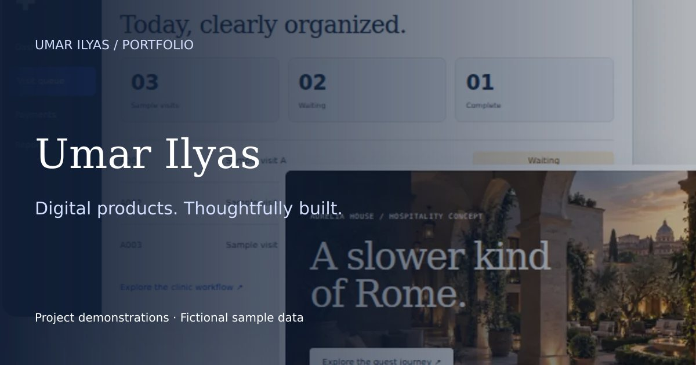

<p align="center"></p>

# Umar Ilyas

**Web Developer & AI Workflow Builder · Nowshera, Pakistan · Open to remote projects**

I build responsive websites, business dashboard interfaces and practical workflow prototypes. My computer science background and experience in medical credentialing shape how I approach real operational problems: clear information, useful next steps and careful handover.

[View portfolio](https://umarilyas803-hub.github.io/) · [Services & project scope](https://umarilyas803-hub.github.io/web-development.html) · [Connect on LinkedIn](https://www.linkedin.com/in/umar-ilyas-700437268/) · [GitHub profile](https://github.com/umarilyas803-hub)

## Selected work

| Project | Explore | What it demonstrates |
| --- | --- | --- |
| Clinic Desk | [Case study & walkthrough](https://umarilyas803-hub.github.io/clinic-desk.html) | Offline PHP/SQLite visit, payment and print workflow; fictional browser walkthrough |
| Aurelia House | [Case study & walkthrough](https://umarilyas803-hub.github.io/aurelia-house.html) | Bilingual hospitality project with guest and operations scope; sample booking flow |
| Restaurant AI | [Case study & demo](https://umarilyas803-hub.github.io/restaurant-ai.html) | Text/voice ordering concept, staff review and operations dashboard |
| SportsHub | [Case study & demo](https://umarilyas803-hub.github.io/sportshub.html) | Sports events, player applications and organizer workflows |
| Staywise | [Interactive study](https://umarilyas803-hub.github.io/staywise.html) | Hotel booking requests and a sample front-desk view |
| PanelPilot | [Interactive study](https://umarilyas803-hub.github.io/panelpilot.html) | Provider and payer follow-up workspace |
| ParcelPilot | [Interactive study](https://umarilyas803-hub.github.io/parcelpilot.html) | Orders, packing and inventory workflow |

The portfolio also includes [Ember Café](https://umarilyas803-hub.github.io/cafe.html), [Rift & Route](https://umarilyas803-hub.github.io/travel.html), [ClearHome](https://umarilyas803-hub.github.io/service.html) and [Atlas Helpdesk](https://umarilyas803-hub.github.io/agent.html).

**Project status:** This repository hosts the static portfolio and browser demos. Product studies use fictional brands and sample data. They are not deployed client systems. The Restaurant AI and SportsHub backend projects are described in their case studies; their backend source is not included in this repository. The original Clinic Desk PHP/SQLite application and private Aurelia House Cloudflare/D1 workspace remain separate from the public browser walkthroughs. Live integrations require separate setup and verification.

## Focus

- Responsive websites with clear content and accessible navigation.
- Dashboard interfaces for hospitality, small-business and provider operations.
- Early AI and automation prototypes with explicit human review steps.
- Learning through Python, APIs and practical projects.

## Run locally

No package installation or framework build is required: this is a static HTML, CSS and JavaScript site.

```sh
python -m http.server 8000
```

Open `http://localhost:8000`. Run the repository checks with:

```sh
node scripts/check-html.mjs
node scripts/check-site.mjs
node scripts/check-feedback.mjs
```

## Repository guide

- `index.html`, `portfolio.css`, `studio.css`, `experience.css`, `portfolio-next.css`: homepage and shared design.
- `experience.js`, `product-showcase.js`: navigation, motion, toolkit filters and message preparation.
- `clinic-desk.html`, `aurelia-house.html`, `project-walkthroughs.js`: new project case studies and fictional browser walkthroughs.
- `reviews.html`, `reviews.json`, `feedback.js`: consented client feedback and email preparation.
- `search-visibility.html`: SEO/AEO/GEO scope and useful explanations.
- `web-development.html`: service scope, project examples and FAQs.
- Project HTML/JavaScript files: case studies and sample-data demos.
- `assets/`: project visuals and social-sharing images.
- `robots.txt`, `sitemap.xml`: discovery configuration.
- `.github/workflows/ci.yml`: automated static checks.

## Contact

For project enquiries, [connect with me on LinkedIn](https://www.linkedin.com/in/umar-ilyas-700437268/) or use the [portfolio contact section](https://umarilyas803-hub.github.io/#contact). A useful brief includes the users, current process, desired outcome and timeline.
